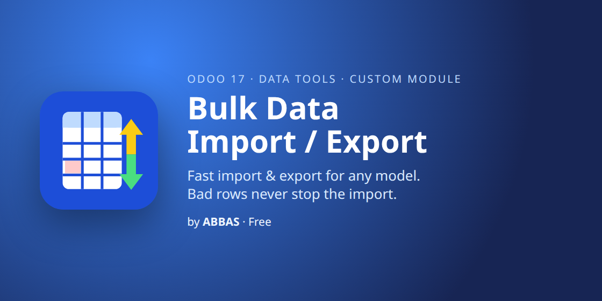

# Bulk Data Import / Export (Odoo 17)

Fast import and export for **any Odoo model**, built for large and messy files.
Free and open source (LGPL-3), by **ABBAS**.

## Why

Odoo's standard import stops at the first error, and nothing is saved until the whole file is clean.
This module saves every good row, sets the bad rows aside, and gives you an **Excel file of the failed rows**
with the reason next to each one. Fix them and import that same file again.

## Features

**Import**
- Excel (.xlsx, .xls) and CSV; columns are matched to fields by technical name or label
- Rows are saved in chunks (500 by default); one bad row never blocks the others
- Excel error report: the failed rows as in your file, plus `__row` and `__error` columns (ignored on re-import)
- Big files run in the background (Odoo scheduler), with progress; cancel and resume at any time
- Create, update or both, matching records by any field, External ID (`id`) or database ID (`.id`)
- Optional: empty cells keep current values on update, missing linked records are created by name
- Test run checks the whole file without saving anything
- Template download: required columns plus a sheet describing every field
- One2many lines (e.g. order lines on following rows) stay with their record across chunk boundaries

**Export**
- Any model, filtered with Odoo's domain editor, to Excel or CSV
- Streams records in chunks with flat memory; Excel files continue on a new sheet past 1,048,576 rows
- External ID column and linked records as External IDs, for round trips and moving data between databases

**Performance**
- Uses Odoo's own `load()` with chatter tracking off
- Linked values ("Pakistan", "Units") are looked up once per chunk, not once per row
- Once a file shows errors, each chunk is checked before saving, so bad rows cost no extra save
- Errors that can't be tied to a row are found by splitting the chunk in halves
- The access rights of the user who started the job always apply

## Installation

Copy `bulk_data_import_export` into your addons path, update the apps list and install
**Bulk Data Import / Export**. It depends only on `base`, `web` and `bus`.

Optional system parameters:

| Key | Default | Meaning |
|---|---|---|
| `bulk_data_import_export.inline_rows` | 500 | Imports up to this many rows run immediately; bigger ones run in the background |
| `bulk_data_import_export.inline_records` | 20000 | Same for exports |
| `bulk_data_import_export.time_budget` | 50 | Seconds per scheduler run before it hands over to the next run |

## Access

- **Bulk Import / Export: User**: own jobs
- **Bulk Import / Export: Administrator**: all jobs (given to Settings administrators)

## Available for Odoo 17, 18 and 19

| Odoo | Price | Get it |
|---|---|---|
| 17 (v1) | Free (LGPL-3) | [Odoo Apps Store](https://apps.odoo.com/apps/modules/17.0/bulk_data_import_export) |
| 18 (v2) | $39 (one-time, OPL-1) | [Odoo Apps Store](https://apps.odoo.com/apps/modules/18.0/bulk_data_import_export) |
| 19 (v2) | $39 (one-time, OPL-1) | [Odoo Apps Store](https://apps.odoo.com/apps/modules/19.0/bulk_data_import_export) |

## Support

abbasodolution@gmail.com
